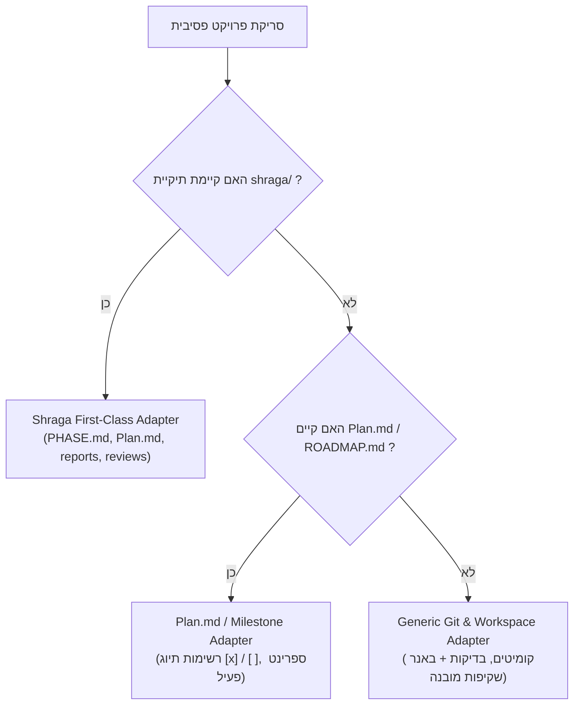

# 🛰️ Orbit Dashboard — Project Companion (v1.1.0)

[](https://github.com/dymvie-alt/orbit-dashboard)
[](https://github.com/dymvie-alt/orbit-dashboard)
[](https://github.com/dymvie-alt/orbit-dashboard)
[](https://github.com/dymvie-alt/orbit-dashboard)
[](https://github.com/dymvie-alt/orbit-dashboard)

**Orbit Dashboard** הוא מלווה פיתוח חכם (Project Companion) עבור מערכת **Google Antigravity**, המעניק מבט-על רציף ("מעוף הציפור") על התקדמות הפרויקט בזמן אמת. המערכת פועלת ברקע באופן פסיבי ומאובטח לחלוטין (Read-Only) מבלי לשנות או לזהם אף קובץ בקוד שלך.

---

## 📖 תוכן עניינים (Table of Contents)
1. [אודות Orbit Dashboard](#-אודות-orbit-dashboard)
2. [עקרונות הברזל והארכיטקטורה](#-עקרונות-הברזל-והארכיטקטורה)
3. [מנוע המתאמים (Workflow Adapters)](#-מנוע-המתאמים-workflow-adapters)
4. [מדריך הפעלה מהיר (Quick Start)](#-מדריך-הפעלה-מהיר-quick-start)
5. [אירוח כפול (Dual-Display)](#-אירוח-כפול-dual-display)
6. [בקרת איכות ואימות (QA Gate)](#-בקרת-איכות-ואימות-qa-gate)
7. [מבנה הקבצים במאגר](#-מבנה-הקבצים-במאגר)

---

## 📌 אודות Orbit Dashboard

### עברית:
> **Orbit Dashboard** הוא מלווה הפיתוח החכם שלך, המעניק מבט-על רציף ("מעוף הציפור") על התקדמות הפרויקט בזמן אמת. המערכת פועלת ברקע באופן פסיבי ומאובטח לחלוטין (Read-Only) מבלי לשנות או לזהם אף קובץ בקוד שלך.  
> Orbit מזהה באופן אוטומטי את שיטת העבודה והניהול של הפרויקט (מתודולוגיית "שרגא", תוכניות עבודה מבוססות פאזות, או פעילות קוד ו-Git עצמאית), שואבת את שפת העיצוב של המוצר, ומשקפת לך במבט אחד מהיר (ללא צורך בגלילה) איפה הפרויקט עומד, מה מבוצע ממש עכשיו בקוד, מה שער האיכות הבא, ומה הצעד המעשי הנדרש לסיום.

### English:
> **Orbit Dashboard** is your intelligent development companion, providing a continuous bird's-eye view of your project's live progress. Operating in a completely passive and secure read-only mode, Orbit observes your workspace without modifying or polluting any files in your codebase.  
> Orbit automatically detects your project's workflow and governance framework (Shraga multi-agent harness, milestone-driven phase plans, or ad-hoc Git/codebase activity), dynamically inherits your product's native design system, and delivers a zero-scroll, single-view dashboard. At a glance, you always know where you are, what is currently being built, quality gate verdicts, and the exact next step required to ship.

---

## 🛡️ עקרונות הברזל והארכיטקטורה
1. **Strict Zero-Footprint (Read-Only):** סריקת הקוד אינה יוצרת, משנה או נוגעת באף קובץ בתיקיית הפרויקט הנסרק. כל הטלמטריה וקובצי ה-HTML נשמרים במרחב מבודד:  
   `~/.gemini/antigravity/orbit/projects/<project-hash>/`
2. **תקציב מסך קשיח 100dvh (Zero-Scroll):** ממשק 3 עמודות פרופורציונלי שאינו דורש גלילת חלון אנכית, מותאם לצפייה מהירה ומסכים מגוונים.
3. **מנוע אמת קפדני (Honest State Machine):**
   * `✓` **ירוק:** הושלם ואומת בבדיקות / אושר בביקורת ארכיטקטורה.
   * `⚡` **אינדיגו פועם:** פעיל ונכתב כעת בקוד.
   * `○` **אפור מעומעם:** מתוכנן לשלבים הבאים (לעולם לא יסומן V טרם זמנו).
4. **מכונת זמן פאזות (Interactive Phase History):** לחיצה על כל שלב בסרגל העליון מאפשרת צפייה בהיסטוריה או בתכנון העתידי, עם כפתור איפוס לפאזה הפעילה.
5. **שעון דופק יחסי (Live Ticker):** מונה שניות חי המתעדכן כל שנייה ("ממש עכשיו", "לפני 20 שניות") המונע תחושת מסך קפוא.
6. **מודאל מידע Glassmorphism (`?`):** פתיחה בלחיצה או במקש `Esc`, כולל פסקת ה-About, מטא-דאטה של המתאם הפעיל ומקשי קיצור.

---

## 🗺️ מנוע המתאמים (Workflow Adapters)



---

## 🚀 מדריך הפעלה מהיר (Quick Start)

### הפעלה בסלאש קומנד:
```bash
/orbit
```
**כינויים וטריגרים נוספים:** `/dashboard`, `/dash`, `דשבורד`, `מעוף הציפור`, `סטטוס פרויקט`.

### רענון יזום:
```bash
/orbit refresh
```

---

## 🖥️ אירוח כפול (Dual-Display)
* **Embedded Mode:** ווידג'ט חי בתוך שיחת הצ'אט של Antigravity.
* **Standalone Browser Mode:** פתיחת הדשבורד בדפדפן (Chrome / Edge / Firefox) למסך עבודה שני, כולל **Soft-Sync חלק ללא הבהוב** שדוגם את ה-JSON ומעדכן את ה-DOM ללא ריענון עמוד מלא.

---

## 🧪 בקרת איכות ואימות (QA Gate)
הפלאג-אין נבדק תחת מפרט QA קפדני בן 12 תרחישי בדיקה (`tests/run-all-tests.mjs`):
* **אימות Zero-Footprint מתמטי:** 100% שוויון בינארי בתיקיית היעד.
* **ביצועי סריקה:** 4.55ms (רף מקסימלי: < 200ms).
* **בידוד בריבוי פרויקטים:** הפרדה מוחלטת של מזהי Hash ותיקיות.
* **ציון איכות:** **12/12 בדיקות עברו בהצלחה (100% Pass Rate)**.

---

## 📁 מבנה הקבצים במאגר
```
orbit-dashboard/
├── plugin.json                 # מניפסט הפלאג-אין הרשמי ל-Antigravity (v1.0.0)
├── README.md                   # תיעוד מלא בעברית ובאנגלית
├── docs/                       # מסמכי תכנון ואיכות מאושרים
│   ├── PRD.md                  # מסמך דרישות המוצר המלא
│   ├── Plan.md                 # תוכנית הפאזות והשלבים
│   └── QA_TEST_PLAN.md         # תוכנית הבדיקות המקיפה (Senior QA Gate)
├── skills/                     # סקילי הפלאג-אין
│   └── orbit/
│       └── SKILL.md            # פלייבוק ההפעלה, Onboarding ושאלות מנחות
├── templates/                  # מנוע התצוגה ה-100dvh
│   └── orbit-view.html         # תבנית HTML עצמאית ללא גלילה + סנכרון רך
├── adapters/                   # מנוע המתאמים
│   ├── adapter-orchestrator.mjs # מנהל התיאום, ביצועים ומדידת זמנים
│   ├── shraga-adapter.mjs      # מתאם שרגא (7 שלבים, דוחות ופסקי דין)
│   ├── plan-adapter.mjs        # מתאם Plan.md ומשימות
│   ├── git-adapter.mjs         # מתאם Git גנרי + באנר שקיפות
│   └── theme-extractor.mjs     # שאיבת צבעים מקבצי עיצוב
├── scripts/                    # סקריפטי ריצה וסריקה
│   └── orbit-scanner.mjs       # מנוע הסריקה ב-CLI וב-Daemon
└── tests/                      # מערך הבדיקות האוטומטי
    ├── run-all-tests.mjs       # מריץ כל 12 בדיקות ה-QA המלאות
    ├── test-ui-template.mjs    # אימות תבנית ה-UI והמרקרים
    ├── test-adapters.mjs       # אימות המתאמים ואפס-מגע
    └── test-onboarding-daemon.mjs # אימות בידוד בריבוי פרויקטים
```
