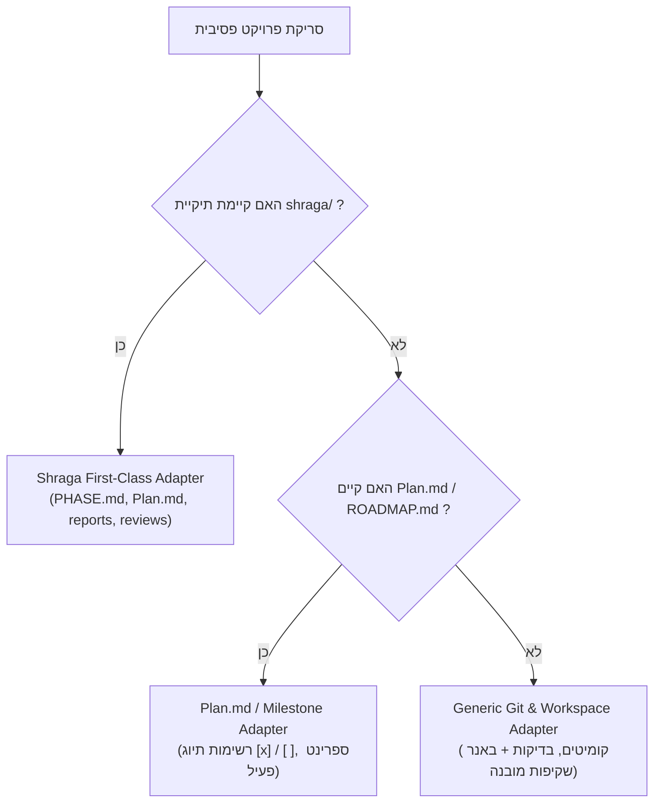

# 🛰️ Orbit Dashboard — Multi-Project Hub & Companion (v2.2.0)

[](https://github.com/dymvie-alt/orbit-dashboard)
[](https://github.com/dymvie-alt/orbit-dashboard)
[](https://github.com/dymvie-alt/orbit-dashboard)
[](https://github.com/dymvie-alt/orbit-dashboard)
[](https://github.com/dymvie-alt/orbit-dashboard)
[](https://github.com/dymvie-alt/orbit-dashboard)

**Orbit Dashboard** הוא מרכז בקרה רב-פרויקטלי (Multi-Project Hub) ומלווה פיתוח חכם עבור **Google Antigravity**, **Claude Code** ו-**Cursor**, המעניק מבט-על רציף ("מעוף הציפור") על התקדמות כל הפרויקטים שלך בזמן אמת מחלון אחד קבוע וללא גלילה. המערכת פועלת ברקע באופן פסיבי ומאובטח לחלוטין (Read-Only) מבלי לשנות או לזהם אף קובץ בקוד שלך.

---

## 📖 תוכן עניינים (Table of Contents)
1. [מדריך התקנה ופריסה במחשב חדש](#-מדריך-התקנה-ופריסה-במחשב-חדש)
2. [אודות Orbit Dashboard (עברית ואנגלית)](#-אודות-orbit-dashboard)
3. [יכולות מרכז הבקרה הרב-פרויקטלי (v2.2.0)](#-יכולות-מרכז-הבקרה-הרב-פרויקטלי-v220)
4. [עקרונות הברזל והארכיטקטורה](#-עקרונות-הברזל-והארכיטקטורה)
5. [מנוע המתאמים (Workflow Adapters)](#-מנוע-המתאמים-workflow-adapters)
6. [מדריך הפעלה שוטפת (Quick Start)](#-מדריך-הפעלה-שוטפת-quick-start)
7. [בקרת איכות ואימות (QA Gate)](#-בקרת-איכות-ואימות-qa-gate)
8. [מבנה הקבצים במאגר](#-מבנה-הקבצים-במאגר)

---

## 💻 מדריך התקנה ופריסה במחשב חדש

### דרישות קדם במחשב היעד:
* מערכת הפעלה Windows (נתמך גם ב-macOS/Linux עם Node.js).
* מותקן **Node.js** (גרסה 18 ומעלה — להורדה מ-[nodejs.org](https://nodejs.org)).

---

### דרך א': התקנה בלחיצה כפולה מתוך קובץ ה-ZIP (המהירה ביותר)
1. העבר למחשב החדש את הקובץ `orbit-dashboard-v2.2.0-installer.zip`.
2. חלץ את ה-ZIP לתיקייה כלשהי (או פתח אותו ישירות) ולחץ לחיצה כפולה על הקובץ **`Install-Orbit.bat`**.
3. המתקין העצמאי יבצע אוטומטית:
   * התקנת הפלאגין בנתיב התקני של המשתמש במחשב החדש:  
     `C:\Users\<Username>\.gemini\config\plugins\orbit-dashboard`
   * זיהוי וסריקה אוטומטית של תיקיות פרויקטים קיימות במחשב (כגון `C:\CLAUDE PROJECTS`, `Documents\antigravity`, `Projects` או `Desktop`).
   * יצירה ופתיחה מיידית של **מרכז הבקרה המאוחד (Orbit Hub)** בדפדפן!

---

### דרך ב': התקנה ישירה מ-GitHub (ללא קובץ ZIP)
ניתן להריץ בטרמינל PowerShell במחשב החדש פקודה אחת שמשכפלת ומתקינה את המערכת:
```powershell
git clone https://github.com/dymvie-alt/orbit-dashboard.git "$env:USERPROFILE\.gemini\config\plugins\orbit-dashboard"; & "$env:USERPROFILE\.gemini\config\plugins\orbit-dashboard\Install-Orbit.bat"
```

---

### דרך ג': הרצה וסנכרון על פרויקט ספציפי משורת הפקודה (למשתמשי Claude Code / Cursor)
לסריקה או חיבור של תיקיית פרויקט חדשה בכל מיקום במחשב:
```powershell
node "$env:USERPROFILE\.gemini\config\plugins\orbit-dashboard\scripts\orbit-scanner.mjs" --project "C:\Path\To\YourProject"
```
מרכז הבקרה הראשי זמין תמיד לפתיחה בדפדפן בנתיב:
```text
C:\Users\<Username>\.gemini\antigravity\orbit\index.html
```

---

## 📌 אודות Orbit Dashboard

### עברית:
> **Orbit Dashboard** הוא מלווה הפיתוח החכם שלך, המעניק מבט-על רציף ("מעוף הציפור") על התקדמות הפרויקטים שלך בזמן אמת מחלון אחד. המערכת פועלת ברקע באופן פסיבי ומאובטח לחלוטין (Read-Only) מבלי לשנות או לזהם אף קובץ בקוד שלך.  
> Orbit מזהה באופן אוטומטי את שיטת העבודה והניהול של כל פרויקט (מתודולוגיית "שרגא", תוכניות עבודה מבוססות פאזות, או פעילות קוד ו-Git עצמאית), שואבת את שפת העיצוב של המוצר, ומשקפת לך במבט חטוף בעברית תקנית (ללא צורך בגלילה) איפה כל פרויקט עומד, מה נבנה כעת בקוד, איזה פרויקט סיים שלב וממתין לך, ומה הצעד המעשי הבא.

### English:
> **Orbit Dashboard** is your intelligent Multi-Project Hub and development companion, providing a continuous bird's-eye view of all your active projects in real time from a single window. Operating in a completely passive and secure read-only mode, Orbit observes your workspaces without modifying or polluting any files in your codebase.  
> Orbit automatically detects each project's workflow (Shraga multi-agent harness, milestone-driven phase plans, or ad-hoc Git activity), inherits native design tokens, and highlights background projects with a visual Focus Beacon the moment a phase completes or a build report is ready.

---

## 🌟 יכולות מרכז הבקרה הרב-פרויקטלי (v2.2.0)

1. **סרגל פרויקטים אנכי בימין המסך (Right Project Dock):**
   * מציג את כל הפרויקטים הפעילים שלך ברצועת צד ימנית קומפקטית ומתאים את גובה הכפתורים אוטומטית למספר הפרויקטים (אפס גלילה).
   * מעבר מיידי (0ms) בלחיצת עכבר או באמצעות מקשי הספרות `1` עד `9` במקלדת.
   * אפשרות כיווץ הסרגל לרצועת אייקונים צרה בלחיצה על `❮`.
2. **הוספת פרויקט מתיבת בחירה ("+ הוסף פרויקט להצגה"):**
   * כפתור קבוע בתחתית הסרגל הפותח חלונית בחירה בעברית: **"בחר תיקייה של הפרויקט להצגה"**.
   * כולל גילוי אוטומטי של פרויקטים במחשב וכן פתיחת סייר תיקיות (`Folder Picker`) או הזנת נתיב.
3. **מנוע מיקוד והבלטת סיום שלב (Focus Beacon — ללא צליל):**
   * כאשר אתה עובד על פרויקט א', ובפרויקט ב' ברקע מתרחש **מעבר שלב/פאזה**, **הגשת דו״ח ביצוע (Report)**, **סיום סקירה (Review)** או **סיום כל תוכנית הפרויקט** — הכפתור של פרויקט ב' בסרגל הימני נדלק ב**מסגרת זהובה פועמת** עם תגית `🔔 שלב הושלם! עבור לכאן 👈`.
   * לחיצה על הפרויקט המואר מעבירה אותך אליו ומאפסת את ההתראה אוטומטית.
4. **תצוגה עברית נקייה במבט חטוף + הרחבה בלחיצה ("הרחב ▾"):**
   * כל רכיב בשלב מוצג כברירת מחדל בשורה אחת תמציתית וברורה בעברית (מיושרת לימין ב-RTL מלא), לצד תגית אמת חיה מהשטח (`✓ קיים בקוד` או `בבנייה`).
   * לחיצה על כל שורה (או על `הרחב הכל ▾`) פותחת באקורדיון עדין את הפירוט הטכני המלא ושמות הקבצים.

---

## 🛡️ עקרונות הברזל והארכיטקטורה
1. **Strict Zero-Footprint (Read-Only):** סריקת הקוד אינה יוצרת, משנה או נוגעת באף קובץ בתיקיית הפרויקט הנסרק. כל הטלמטריה וקובצי ה-HTML נשמרים במרחב מבודד:  
   `~/.gemini/antigravity/orbit/`
2. **תקציב מסך קשיח 100dvh (Zero-Scroll):** רשת 12 עמודות אסימטרית (4 ימין למהות ומדדים, 5 מרכז לתכולת השלב, 3 שמאל לצעד הבא) לצד סרגל הפרויקטים הימני, המנצלת את המסך במלואו בזום 100% ללא גלילת חלון.
3. **מנוע אמת קפדני (Honest State Machine):** בודק בזמן אמת האם הקבצים שהוגדרו בתוכנית כבר נוצרו בדיסק ומעדכן את הסטטוס ל-`✓ קיים בקוד`.
4. **מכונת זמן פאזות (Interactive Phase History):** לחיצה על כל שלב בסרגל העליון מאפשרת צפייה בהיסטוריה או בתכנון העתידי, עם כפתור חזרה לשלב הפעיל.

---

## 🗺️ מנוע המתאמים (Workflow Adapters)



---

## 🚀 מדריך הפעלה שוטפת (Quick Start)

### הפעלה מתוך Antigravity:
```bash
/orbit
```
**כינויים וטריגרים נוספים:** `/dashboard`, `/dash`, `דשבורד`, `מעוף הציפור`, `סטטוס פרויקט`.

### מקשי קיצור בדשבורד:
* `1` עד `9` — מעבר מיידי בין פרויקטים בסרגל הימני.
* `T` — החלפה בין מצב בהיר (Light) למצב כהה (Dark).
* `R` — רענון נתונים מיידי.
* `Esc` — סגירת חלוניות ("אודות" / "הוסף פרויקט").

---

## 🧪 בקרת איכות ואימות (QA Gate)
הפלאג-אין נבדק תחת מפרט QA קפדני בן 12 תרחישי בדיקה אוטומטיים (`tests/run-all-tests.mjs`):
* **אימות Zero-Footprint מתמטי:** 100% שוויון בינארי בתיקיית היעד לפני ואחרי סריקה.
* **ביצועי סריקה:** ~2.5ms לפרויקט (רף מקסימלי: < 200ms).
* **בידוד וסנכרון בריבוי פרויקטים:** ניהול מרכזי ב-`orbit-hub.json` לצד תיקיות מבודדות לכל פרויקט.
* **ציון איכות:** **12/12 בדיקות עברו בהצלחה (100% Pass Rate)**.

---

## 📁 מבנה הקבצים במאגר
```
orbit-dashboard/
├── Install-Orbit.bat           # מתקין אוטומטי בלחיצה כפולה (עובד גם ישירות מתוך ZIP)
├── install-orbit.ps1           # סקריפט התקנה ופתיחה ב-PowerShell
├── INSTALL-HEBREW.md           # מדריך התקנה קצר בעברית למשתמש חדש
├── plugin.json                 # מניפסט הפלאג-אין הרשמי ל-Antigravity (v2.2.0)
├── README.md                   # תיעוד מלא ומדריך התקנה והפעלה
├── docs/                       # מסמכי תכנון ואיכות מאושרים
│   ├── PRD.md                  # מסמך דרישות המוצר המלא
│   ├── Plan.md                 # תוכנית הפאזות והשלבים
│   └── QA_TEST_PLAN.md         # תוכנית הבדיקות המקיפה (Senior QA Gate)
├── skills/                     # סקילי הפלאג-אין
│   └── orbit/
│       └── SKILL.md            # פלייבוק ההפעלה, Onboarding ושאלות מנחות
├── templates/                  # מנוע התצוגה ה-100dvh (Multi-Project Hub)
│   └── orbit-view.html         # תבנית HTML עצמאית ללא גלילה + סרגל פרויקטים ו-Focus Beacon
├── adapters/                   # מנוע המתאמים והתרגום העברי
│   ├── adapter-orchestrator.mjs # מנהל התיאום, ביצועים ומדידת זמנים
│   ├── hebrew-normalizer.mjs   # מנוע תמצות אנושי בעברית (RTL) ואימות קבצים חי
│   ├── shraga-adapter.mjs      # מתאם שרגא (כולל תמיכה בשלב אפיון ראשוני לפני Plan.md)
│   ├── plan-adapter.mjs        # מתאם Plan.md ומשימות
│   ├── git-adapter.mjs         # מתאם Git גנרי + באנר שקיפות
│   └── theme-extractor.mjs     # שאיבת צבעים מקבצי עיצוב ואכיפת ניגודיות WCAG AAA
├── scripts/                    # סקריפטי ריצה וסריקה
│   └── orbit-scanner.mjs       # מנוע הסריקה הרב-פרויקטלי, זיהוי תיקיות והתראות FOCUS
└── tests/                      # מערך הבדיקות האוטומטי
    ├── run-all-tests.mjs       # מריץ כל 12 בדיקות ה-QA המלאות
    ├── test-ui-template.mjs    # אימות תבנית ה-UI והמרקרים
    ├── test-adapters.mjs       # אימות המתאמים ואפס-מגע
    └── test-onboarding-daemon.mjs # אימות בידוד בריבוי פרויקטים
```
