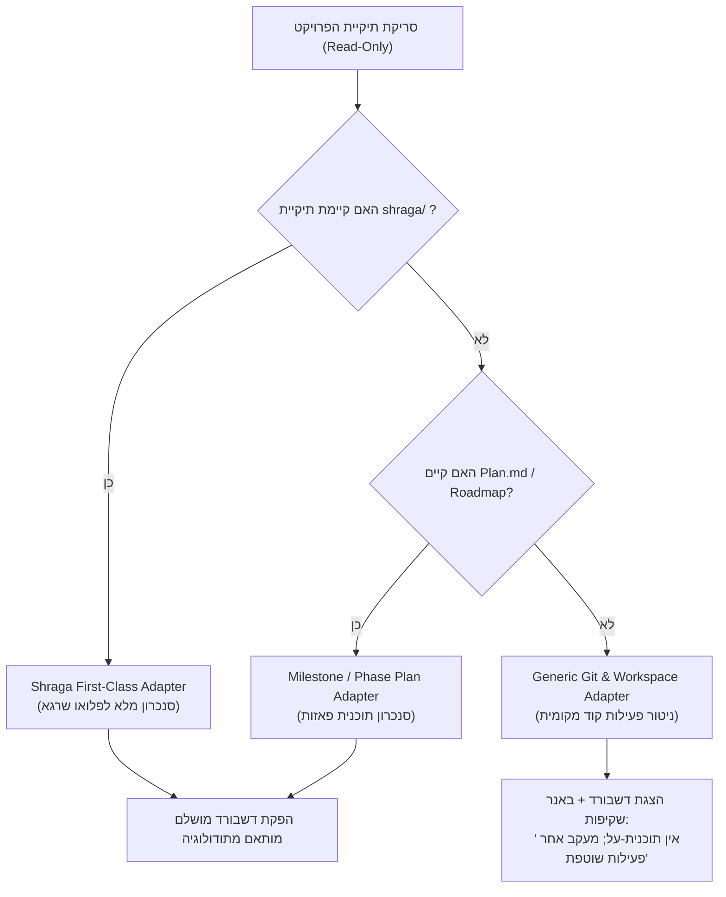

# 🛰️ Orbit Dashboard — Product Requirements Document (PRD)
**Project / Plugin Name:** `Orbit Dashboard` (`Orbit`)  
**Primary Trigger & Slash Command:** `/orbit` (Aliases & Hebrew Triggers: `דשבורד`, `DASHBOARD`, `DASH`, `dash`)  
**Plugin Nature:** Full Antigravity Plugin Bundle (Skill + Background Daemon + Generative UI Template Engine)  
**Document Status:** Final Draft for Alignment (גרסת אפיון סופית ליישור קו)

---

## 📌 מבוא ופסקת "אודות" (About Orbit)
> *פסקה זו מנוסחת עבור משתמשי הקצה ותוטמע ישירות בתוצר הסופי של הדשבורד תחת כפתור העזרה והמידע (`?`):*

### עברית: אודות Orbit Dashboard
> **Orbit Dashboard** הוא מלווה הפיתוח החכם שלך, המעניק מבט-על רציף ("מעוף הציפור") על התקדמות הפרויקט בזמן אמת. המערכת פועלת ברקע באופן פסיבי ומאובטח לחלוטין (Read-Only) מבלי לשנות או לזהם אף קובץ בקוד שלך.  
> Orbit מזהה באופן אוטומטי את שיטת העבודה והניהול של הפרויקט (מתודולוגיית "שרגא", תוכניות עבודה מבוססות פאזות, או פעילות קוד ו-Git עצמאית), שואבת את שפת העיצוב של המוצר, ומשקפת לך במבט אחד מהיר (ללא צורך בגלילה) איפה הפרויקט עומד, מה מבוצע ממש עכשיו בקוד, מה שער האיכות הבא, ומה הצעד המעשי הנדרש לסיום.

### English: About Orbit Dashboard
> **Orbit Dashboard** is your intelligent development companion, providing a continuous bird's-eye view of your project's live progress. Operating in a completely passive and secure read-only mode, Orbit observes your workspace without modifying or polluting any files in your codebase.  
> Orbit automatically detects your project's workflow and governance framework (Shraga multi-agent harness, milestone-driven phase plans, or ad-hoc Git/codebase activity), dynamically inherits your product's native design system, and delivers a zero-scroll, single-view dashboard. At a glance, you always know where you are, what is currently being built, quality gate verdicts, and the exact next step required to ship.

---

```
================================================================================
                         חלק א': אפיון המוצר בעברית
================================================================================
```

## 1. חזון ומטרות המוצר
1. **שקיפות וליווי בזמן אמת:** להציג למפתח/מנהל הפרויקט בכל רגע נתון סטטוס אמין ומדויק של הפרויקט ללא תלות בסשן ה-Chat שבו מתבצע הפיתוח.
2. **אפס מגע בקובצי הפרויקט (Strict Zero-Footprint & Read-Only):** המערכת סורקת את קובצי הפרויקט באופן פסיבי בלבד; כל קובצי הדשבורד, המצב והזיכרון נשמרים מחוץ לתיקיית הפרויקט (במרחב המבודד של Antigravity).
3. **ניצול מסך מרבי ללא גלילה (Zero-Scroll 100dvh):** צפייה בכל המידע הקריטי במבט אחד (Single Glance), מותאם למסכי עבודה רגילים, רחבים ולמסכי מובייל.
4. **תמיכה בריבוי פרויקטים (Multi-Project):** ניהול מופע דשבורד עצמאי לכל פרויקט/תיקייה, עם יכולת לפתוח ולעקוב אחרי מספר פרויקטים במקביל.
5. **אירוח כפול: מוטמע בצ'אט ובדפדפן נפרד:** תמיכה הן בווידג'ט חי בתוך השיחה (`<agent-embed>`), והן בכתובת עצמאית לפתיחה במסך עבודה שני (Multi-Monitor Workflow).

---

## 2. מנוע הזיהוי והמתאמים (Workflow Adapters Engine)
Orbit אינו כבול לכלי יחיד אלא כולל מנוע Adapters חכם המזהה את תצורת הפרויקט בעת ה-Onboarding:



### פירוט המתאמים (Adapters):
1. **Shraga Adapter (First-Class Harness):**
   * מנטר את: `shraga/PHASE.md`, `shraga/Plan.md`, `shraga/prompts/`, `shraga/reports/`, ו-`shraga/reviews/`.
   * משקף בדיוק את 7 שלבי פלואו שרגא: הגדרת צורך -> תכנון -> פרומפט פאזה -> סשן בנייה פעיל -> ביקורת איכות עצמאית (Approved / Rejected) -> סגירת פאזה -> קידום שלב.
2. **Plan & Milestone Adapter:**
   * מזהה קובצי תוכנית עבודה עצמאיים (`Plan.md`, `ROADMAP.md`, `tasks.md`).
   * מחלץ פאזות, רשימות תיוג (Checklists), ומצב משימות (הושלם, בביצוע, עתידי).
3. **Generic Git & Activity Adapter:**
   * מופעל כאשר אין מתודולוגיה מובנית בפרויקט.
   * סורק היסטוריית קומיטים, בדיקות יחידה (`npm test`, `pytest`), קבצים שנערכו לאחרונה ותקינות בנייה.
   * **שקיפות מובנית:** מציג באנר ברור: *"הפרויקט מתנהל ללא תוכנית-על מובנית (Zoom-out roadmap); הדשבורד משקף פעילות קוד ואיכות מקומית."*

---

## 3. ארכיטקטורת הממשק (Dashboard UI Architecture)
הממשק מבוסס על שפת העיצוב המנצחת שנוסתה בהצלחה בקל כסף, עם תקציב גובה קשיח של `100dvh`:

```
+-----------------------------------------------------------------------------------------+
| [🪙 לוגו] Orbit: [שם הפרויקט] | [תג פאזה פעילה]        [? אודות] [דופק: לפני 12 שנ'] [סריקה] |
+-----------------------------------------------------------------------------------------+
| [0: תשתית ✓] [1: ליבה ✓] [2: פיצ'רים ✓] [3: בדיקות ⚡] [4: השקה ○] ... (סרגל פאזות אינטראקטיבי)|
+---------------------------------------------------------+-------------------------------+
| עמודה 1: הקשר ומאקרו      | עמודה 2: תכולה וקוד חי       | עמודה 3: שער איכות והצעד הבא |
| • מהות הפאזה ומשמעותה    | • רכיב א' [✓ אושר]          | • פסק דין ביקורת (Approved)   |
| • מטרות הליבה של השלב    | • רכיב ב' [⚡ נכתב כעת בקוד] | • תנאים וחובות איכות פתוחים |
| • מדדים: טסטים, כיסוי,   | • רכיב ג' [○ מתוכנן להמשך]   | • הנחיה ברורה ומודגשת:      |
|   ביצועים, ניגודיות נגישות| • עדכוני בדיקות בזמן אמת   |   "מה עושים עכשיו ב-Claude"   |
+---------------------------------------------------------+-------------------------------+
```

### עקרונות ברזל של הממשק:
1. **חוק האמת במצב (Honest State Engine):**  
   שימוש בשלושה מצבים ויזואליים בלבד – `✓` (הושלם ואומת בבדיקות), `⚡` פועם (פעיל ונכתב כעת בקוד), ו-`○` (מתוכנן לשלבים הבאים). לעולם לא יסומן V על משימה עתידית.
2. **מכונת זמן אינטראקטיבית (Phase Time-Machine):**  
   לחיצה על כל פאזה בסרגל העליון טוענת מיד את תמונת המצב ההיסטורית של אותה פאזה, כאשר כפתור ייעודי או ברירת המחדל תמיד מאפסים לפאזה הפעילה כעת.
3. **שעון דופק רץ ב-JS (Live Ticking Engine):**  
   מונה שניות מקומי המתעדכן בכל שנייה ("ממש עכשיו", "לפני 24 שניות", "לפני דקה") – מונע תחושת מסך קפוא ומבטיח שהמידע רענן.
4. **מודאל "אודות" (`?` Modal Drawer):**  
   כפתור עדין ב-Header הפותח חלון Glassmorphism עם פסקת ה-About, מטא-דאטה של הפרויקט, המתאם הפעיל (Shraga/Plan/Generic), תדירות הסריקה ומקשי קיצור.

---

## 4. מנוע העיצוב והתאמה ויזואלית (Theming Engine)
1. **זיהוי אוטומטי:** המערכת תסרוק אחר `DESIGN_SYSTEM.md`, קובצי Tailwind config, או משתני CSS (`:root`). במידה ונמצאו צבעים וגופנים – הדשבורד יאמץ אותם אוטומטית.
2. **עיצוב ברירת מחדל מודרני (Fallback Theme):**  
   אם מדובר בפרויקט ללא ממשק משתמש (Backend, CLI, דאטה), יופעל עיצוב ברירת מחדל אלגנטי, נקי ויוקרתי:
   * **פלטה:** רקע כהה/בהיר ניטרלי (Slate/Zinc), כרטיסים צפים מודרניים, הדגשות בכחול-אינדיגו עמוק (`#4f46e5`) ואזמרגד (`#10b981`).
   * **טיפוגרפיה:** גופן מערכת עברי/לועזי נקי (Assistant, Inter, Segoe UI).

---

## 5. אוטומציה, סריקת רקע ואירוח כפול
1. **מנוע סריקה ברקע (Background Daemon):**
   * שימוש במנגנון ה-`schedule` של Antigravity לביצוע בדיקה תקופתית.
   * **ברירת מחדל:** בדיקה כל 2 דקות.
   * **התאמה אישית:** המשתמש יכול לבחור 1, 2, או 5 דקות בעת ההפעלה, או לבקש רענון ידני (`/orbit refresh`).
   * **שקט תעשייתי:** הניטור רץ כ-Daemon שקט ומעדכן את קובץ הנתונים וה-HTML בלי לייצר הודעות ספאם בשיחה.
2. **אירוח כפול (Dual Display):**
   * **Embedded:** מוצג בתוך ה-Chat כרכיב אינטראקטיבי באמצעות `<agent-embed>`.
   * **Standalone Browser View:** קובץ ה-HTML יישמר בנתיב קבוע וייפתח בלחיצת כפתור בכל דפדפן (Chrome / Edge / Firefox) לטובת עבודה על מסך שני.
   * **Live Soft-Sync (ללא הבהוב):** קובץ ה-HTML כולל סקריפט JavaScript עצמאי שדוגם את קובץ ה-State המקומי, ומעדכן את ה-DOM בחלקלקות (DOM patching) ללא צורך בריענון עמוד מלא.

---

## 6. תמיכה בריבוי פרויקטים (Multi-Project Support)
* כל פרויקט מקבל מזהה ייחודי (`Project-ID`) הנגזר משם התיקייה והנתיב שלו.
* כל נתוני הדשבורד נשמרים בתיקייה המבודדת:  
  `<appDataDir>/plugins/orbit-dashboard/projects/<project-hash>/`
* המשתמש יכול לפתוח מספר חלונות מעקב עבור פרויקטים שונים בו-זמנית.

---

```
================================================================================
                    PART B: PRODUCT SPECIFICATION (ENGLISH)
================================================================================
```

## 1. Product Summary & Scope
* **Product Name:** Orbit Dashboard (`Orbit`)
* **Package Format:** Antigravity Plugin Bundle (`orbit-dashboard`)
* **Primary Command:** `/orbit` (Aliases: `dashboard`, `dash`, `דשבורד`)
* **Core Value Proposition:** Real-time, zero-touch, zero-scroll visual companion for AI-accelerated software engineering.

## 2. Technical Architecture & Component Breakdown

```
+---------------------------------------------------------------------------------+
|                                ORBIT PLUGIN BUNDLE                              |
+---------------------------------------------------------------------------------+
| 1. SKILL (/orbit)         | 2. ORBIT OBSERVER (DAEMON)  | 3. GENERATIVE UI ENGINE |
| • Interactive Onboarding  | • Background polling task   | • 100dvh Tailwind card  |
| • Path & Harness discovery| • Read-only file inspection | • Dynamic live ticker   |
| • Frequency configuration | • State JSON serialization  | • Phase time-machine    |
| • Adapter selection       | • In-memory cache & diff    | • Accessible '?' modal  |
+---------------------------------------------------------------------------------+
```

### Component Details:
1. **Interactive Onboarding Skill (`/orbit`):**
   * Inquires: Project root directory path.
   * Inquires: Polling frequency (1m, 2m default, 5m, or manual).
   * Auto-detects workflow harness (Shraga, Plan.md, Git-only).
   * Generates the initial dashboard and launches the background watcher.
2. **Passive Observer Daemon (`orbit-observer`):**
   * Executes via Antigravity `schedule` daemon.
   * Inspects timestamps and hashes of harness files (`PHASE.md`, `Plan.md`, reports, reviews, git log).
   * Serializes normalized project telemetry into `orbit-state.json`.
3. **Generative UI Template Engine (`orbit-view.html`):**
   * Renders the 3-column, zero-scroll dashboard layout.
   * Soft-polls `orbit-state.json` every few seconds to refresh the cards smoothly without reloading the browser tab.
   * Embeds the "About Orbit" introduction under the Header `?` modal.

## 3. Harness Adapters Specification

| Adapter | Trigger Condition | Data Sources | Output Mapping |
| :--- | :--- | :--- | :--- |
| **Shraga Adapter** | Exists: `shraga/` directory | `PHASE.md`, `Plan.md`, `prompts/`, `reports/`, `reviews/` | Full 7-stage Shraga lifecycle, verdicts (Approved/Rejected), review violations, risk gates, parent directives. |
| **Milestone Adapter** | Exists: `Plan.md` or `ROADMAP.md` (no `shraga/`) | Root plan markdown files, task lists | Phase tabs, scoped checkboxes (`[x]`, `[ ]`), active sprint. |
| **Git / Generic Adapter** | Fallback (neither of the above) | `git log`, `git status`, test runs (`package.json`, `pytest`, etc.) | Recent commits, build/test health, with a clear transparency banner explaining the absence of a macro-level roadmap. |

## 4. UI/UX Specifications
* **Screen Budget:** Strict `100dvh` (Zero vertical window scrollbar on standard desktop viewports $\ge 1280 \times 800$).
* **Typography:** Adaptive fluid scaling (`min(token, vw)`), preventing empty card voids and maintaining high readability.
* **Color Schemes:**
  * Dynamic: Ingests primary/secondary/accent CSS tokens or Tailwind palette from target project.
  * Neutral Fallback: Dark Slate (`#0f172a`), Crisp Cards (`#1e293b`), Indigo Primary (`#6366f1`), Emerald Success (`#10b981`).
* **The `?` (About) Drawer / Modal:**
  * Clean backdrop blur (`backdrop-blur-md`).
  * Accessible via `Esc`, click outside, or close button.
  * Displays the introductory paragraph, active adapter, scan frequency, and live paths.

## 5. Non-Functional Requirements (NFR)
* **NFR-1 (Zero-Footprint):** Under NO circumstance shall Orbit create, modify, touch, or delete any file inside the monitored project directory.
* **NFR-2 (Performance):** Dashboard payload $< 80\text{ KB}$, initialization $< 500\text{ ms}$, background scan execution $< 200\text{ ms}$.
* **NFR-3 (Multi-Project Isolation):** Multiple projects monitored concurrently without cross-contamination.
* **NFR-4 (Standalone Browser Support):** Standalone HTML opens via local file URI or local loopback with soft JSON polling for flicker-free dual-monitor setups.

---

## 7. תוכנית הפעולה הבאה (Next Steps)
לאחר אישור ה-PRD הנוכחי:
1. **שלב א':** כתיבת מסמך תוכנית פאזות מפורטת (**Plan.md** של פלאג-אין Orbit).
2. **שלב ב':** מעבר לפאזה 0 (הקמת שלד הפלאג-אין, מבנה התיקיות ותבנית העיצוב).

---

> [!IMPORTANT]
> מסמך ה-PRD מוכן כעת לעיונך ולאישורך.  
> האם המבנה, פסקת ה-About, מנוע ה-Adapters, וארכיטקטורת הפלאג-אין מאושרים ומדויקים להמשך? אם ישנם דגשים או התאמות נוספות – נעדכן מיד; אם הכל מאושר – נעבור לשלב ניסוח ה-**Plan**!
