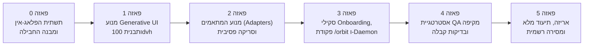

# 📋 תוכנית עבודה ופאזות פיתוח: Orbit Dashboard (Plan.md)
**שם הפרויקט:** `Orbit Dashboard Plugin` (`orbit-dashboard`)  
**סטטוס:** תוכנית פאזות מפורטת לאישור (כולל שלב QA אינטגרלי מורחב)  
**גרסת יעד:** `1.0.0`  
**מבנה ארכיטקטוני:** Antigravity Plugin Bundle מודולרי מלא  

---

## 🗺️ מפת הפאזות וציר הזמן (Phases Roadmap)

---

## פירוט הפאזות ותכולתן

### פאזה 0: תשתית הפלאג-אין ובידוד נתונים (Plugin Foundation & Isolation)
* **מטרה:** הקמת שלד הפלאג-אין התקני במערכת Antigravity והבטחת בידוד מוחלט מתיקיית הפרויקט הנסרק.
* **תכולה:**
  1. יצירת תיקיית הפלאג-אין: `~/.gemini/config/plugins/orbit-dashboard/`.
  2. הגדרת קובץ המניפסט הרשמי `plugin.json` (שם, גרסה 0.1.0, תיאור, פקודות: `/orbit`, כינויים: `דשבורד`, `DASHBOARD`, `dash`).
  3. חלוקת תתי-תיקיות: `skills/orbit/`, `templates/`, `scripts/`, `adapters/`, `tests/`.
  4. הגדרת מרחב אחסון מבודד למצבי הפרויקטים (`~/.gemini/antigravity/orbit/projects/<project-hash>/`) המבטיח **אפס מגע וכתיבה בתיקיית הפרויקט של המשתמש**.
* **קריטריוני קבלה (DoD):**
  * הפלאג-אין מזוהה ונטען תקין במערכת.
  * פקודת `/orbit` זמינה ברישום הפקודות.

---

### פאזה 1: מנוע ה-UI ותבנית 100dvh ללא גלילה (Generative UI & Dual-Display)
* **מטרה:** פיתוח תבנית הדשבורד הדינמית (HTML/Tailwind) המותאמת לתקציב מסך קשיח, שעון שניות חי ואירוח כפול.
* **תכולה:**
  1. **תבנית Zero-Scroll 100dvh:** פריסת 3 עמודות פרופורציונליות וסרגל פאזות עליון אינטראקטיבי המנצלים 100% משטח המסך ללא גלילה אנכית.
  2. **מכונת זמן פאזות (Interactive Phase History):** לחיצה על כל פאזה מציגה את נתוניה ההיסטוריים, עם כפתור איפוס לפאזה הפעילה.
  3. **שעון דופק יחסי רץ ב-JS (Live Ticker):** מונה שניות מקומי המתעדכן בכל שנייה ("ממש עכשיו", "לפני 15 שניות").
  4. **מודאל "אודות Orbit" (`?` Drawer):** חלון Glassmorphism אלגנטי ב-Header הכולל את פסקת ה-About הרשמית, נתוני זיהוי הפרויקט, ומקשי קיצור.
  5. **שפת עיצוב דינמית (Theming Engine):** שאיבת טוקנים וצבעים מקובץ עיצוב, עם Fallback יוקרתי (Slate/Indigo ניטרלי) לפרויקטים ללא ממשק גרפי.
  6. **מנגנון סנכרון רך לדפדפן נפרד (Flicker-Free Standalone Soft-Sync):** דגימת קובץ המצב המקומי (`status.json`) ועדכון ה-DOM בצורה חלקה ללא ריענון עמוד מלא (אידיאלי לעבודה עם מסך שני).
* **קריטריוני קבלה (DoD):**
  * הדשבורד נפתח חלק הן ב-`<agent-embed>` והן בחלון דפדפן נפרד.
  * תצוגה מושלמת ב-100dvh ברזולוציות שונות (1080p, 2K, לפטופ).

---

### פאזה 2: מנוע המתאמים והסריקה הפסיבית (Workflow Adapters Engine)
* **מטרה:** בניית שכבת הסריקה והתרגום שיודעת לקרוא מתודולוגיות עבודה שונות ולנרמל אותן לפורמט אחיד.
* **תכולה:**
  1. **Shraga First-Class Adapter:**
     * קריאת `PHASE.md`, `Plan.md`, תיקיית `prompts/`, `reports/`, ו-`reviews/`.
     * חילוץ תוצאות בדיקות, פסקי דין (Approved/Rejected), הפרות פתוחות, וסעיפי הפעולה הבאה.
  2. **Plan & Milestone Adapter:**
     * קריאת קובצי `Plan.md`, `ROADMAP.md` או `tasks.md`.
     * חילוץ פאזות ורשימות תיוג (`[x]`, `[ ]`).
  3. **Generic Git & Activity Adapter:**
     * חילוץ קומיטים אחרונים מ-Git, סריקת בדיקות אוטומטית (`npm test`, `pytest`) ובדיקות בנייה.
     * הזרקת באנר שקיפות מובנה: *"ללא תוכנית-על (Zoom-out roadmap); משקף פעילות קוד שוטפת"*.
  4. **נרמול ל-`orbit-state.json`:** מבנה נתונים אחיד המזין את מנוע ה-UI.
* **קריטריוני קבלה (DoD):**
  * סריקה של כל אחד משלושת המבנים מפיקה `orbit-state.json` עשיר ותקין תוך פחות מ-200ms.
  * אפס כתיבה או שינוי קבצים בתיקיית היעד הנבדקת.

---

### פאזה 3: סקיל ה-Onboarding וסריקה אוטומטית ברקע (Interactive Skill & Daemon)
* **מטרה:** חיבור חוויית המשתמש המלאה – הפעלה בסלאש, שאלות הכוונה, והפעלת ניטור שקט ברקע.
* **תכולה:**
  1. **שיחת Onboarding אינטראקטיבית (`skills/orbit/SKILL.md`):**
     * בירור נתיב הפרויקט (עם אפשרות לבחירת התיקייה הנוכחית בלחיצה אחת).
     * בירור תדירות סריקה מבוקשת (ברירת מחדל: 2 דק', אפשרויות: 1, 2, 5 דק', או ידני בלבד).
     * זיהוי אוטומטי של המתאם (שרגא / Plan / גנרי) ואישור מול המשתמש.
  2. **תמיכה בריבוי פרויקטים (Multi-Project Daemon):**
     * יצירת Hash ייחודי לכל פרויקט, ניהול תהליכי רקע מבודדים עבור כל תיקייה במקביל.
  3. **סריקה תקופתית שקטה (Daemon Task):**
     * הפעלת מנגנון `schedule` עצמאי המעדכן את קובץ המצב ללא הדפסת ספאם לשיחה.
  4. **רענון יזום ידני:** תמיכה בפקודת רענון מיידית (`/orbit refresh` או "דשבורד רענן").
* **קריטריוני קבלה (DoD):**
  * המשתמש מקליד `/orbit`, עונה על 2 שאלות קצרות, והדשבורד עולה חי ומתעדכן מעצמו כל 2 דקות.

---

### פאזה 4: אסטרטגיית איכות (QA) מקיפה ובדיקות קבלה (Senior QA Gate)
> [!IMPORTANT]
> **שלב זה ינוהל ויבוצע על פי הסטנדרטים הגבוהים ביותר של Test Architecture & QA.**  
> כפי שביקשת, בהגיענו לפאזה זו – אציג בפניך **תוכנית בדיקות מפורטת לאישור מוקדם**, הכוללת מטריצת סיכונים, תרחישי בדיקה, ורציונל מקצועי.

* **תחומי הבדיקה בפאזה 4:**
  1. **בדיקות אימות אפס-מגע (Zero-Footprint Integrity Audit):**
     * אימות מתמטי (Git diff & file checksums) שאף קובץ בתוך תיקיית הפרויקט הנסרק לא נוצר, שונה או נמחק.
  2. **בדיקות מתאמים ואיסוף מידע (Adapter Coverage & Resiliency):**
     * סריקת פרויקט שרגא מלא (כדוגמת "קל כסף").
     * סריקת פרויקט עם `Plan.md` בלבד.
     * סריקת פרויקט ללא שום קובץ תכנון (Git בלבד) ווידוא הופעת באנר השקיפות.
     * בדיקת עמידות מול קבצים פגומים או חסרים (חוסן מפני קריסות).
  3. **בדיקות ממשק, רספונסיביות ותקציב מסך (Visual & 100dvh Viewport Testing):**
     * בדיקת אפס גלילה (No vertical scroll) ברזולוציות: 1920x1080, 1440x900, 2560x1440.
     * בדיקת יחס טקסט-חלל ומניעת חללים ריקים בכרטיסים.
     * בדיקת פתיחת מודאל ה-`?` (About) במקשי מקלדת (`Esc`) ולחיצה מחוץ לחלון.
  4. **בדיקות אירוח כפול (Dual Display & Live Sync):**
     * אימות תצוגה מוטמעת בצ'אט (`<agent-embed>`).
     * אימות תצוגה בדפדפן עצמאי במסך שני ואימות סנכרון חלק (Soft-Sync ללא Flicker).
  5. **בדיקות ביצועים וריבוי פרויקטים (Concurrency & Multi-Project Load):**
     * הפעלת ניטור על 2 פרויקטים שונים בו-זמנית ואימות היעדר זליגת מידע ביניהם.
     * מדידת זמני סריקה (יעד: פחות מ-200ms לסריקה).
* **קריטריוני קבלה (DoD):**
  * 100% מתרחישי הבדיקה בתוכנית ה-QA מאושרים ועוברים בהצלחה.

---

### פאזה 5: אריזה, תיעוד סופי ומסירה (Packaging, Docs & Delivery)
* **מטרה:** הכנת הפלאג-אין להפצה פנימית, התקנה פשוטה ותיעוד מלא למשתמש.
* **תכולה:**
  1. כתיבת `README.md` מקיף בעברית ובאנגלית הכולל מדריך התקנה מהירה ופקודות.
  2. עדכון `SKILL.md` עם דוגמאות שימוש, טריגרים חלופיים (`דשבורד`, `dash`), וטיפול בשגיאות.
  3. אריזת הפלאג-אין, בדיקת התקנה נקייה במערכת Antigravity.
  4. סגירת גרסה `1.0.0` והכרזה על מוצר מוכן לשימוש שוטף בכל הפרויקטים!
* **קריטריוני קבלה (DoD):**
  * התקנה נקייה של הפלאג-אין עובדת מהקופסה ללא תקלות.

---

## 🛡️ מטריצת סיכונים ראשונית (Initial Risk Register)

| מזהה | סיכון פוטנציאלי | רמת חומרה | מענה ארכיטקטוני מובנה |
| :--- | :--- | :--- | :--- |
| **R-1** | סריקת תיקיית הפרויקט תיצור בטעות קובץ מקומי זר | **קריטי** | חסימה ברמת הארכיטקטורה: כל פעולות ה-I/O מול הפרויקט הן Read-Only מוחלט; שמירת נתונים רק בנתיב ה-App Data של הפלאג-אין. |
| **R-2** | עומס טוקנים או ספאם הודעות בשיחה מסריקות תקופתיות | **בינוני** | מנוע הסריקה פועל כ-Daemon שקט שמפיק עדכונים לקובץ מצב מקומי ללא שליחת הודעות צ'אט, אלא אם התרחש אירוע מהותי. |
| **R-3** | פרויקטים ללא שפת עיצוב ייראו שבורים או חיוורים | **נמוך** | מנוע Theming עם Fallback מובנה בעל פלטת צבעים מודרנית (Slate/Indigo) המבטיח מראה פרמיום בכל מצב. |
| **R-4** | הבהוב ריענון מעצבן (Flicker) בחלון דפדפן במסך שני | **בינוני** | ביטול ריענון עמוד מלא (`location.reload`) ומעבר לסנכרון רך של ה-DOM (JSON polling + DOM patch). |

---

> [!NOTE]
> תוכנית הפאזות (Plan.md) מונחת כעת לעיונך ולאישורך.  
> האם המבנה, החלוקה לשלבים והשילוב של פאזה 4 כשלב QA מקצועי עונים על כל ציפיותיך?  
> עם אישורך – נהיה מוכנים לעבור ל**פאזה 0** (הקמת תשתית הפלאג-אין)!
